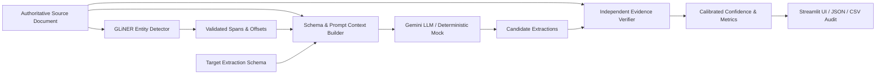

# HTL-VIE: Hybrid Transformer–LLM Evidence-Verified Information Extraction

**Academic Case Study Prototype**
> **Title:** *Transformer-Based Named Entity Recognition and LLM-Based Information Extraction — A Hybrid Evidence-Verified Approach for Reliable Information Extraction.*

---

## 1. Overview & Motivation

Large Language Models (LLMs) excel at zero-shot schema-guided information extraction (IE), yet frequently suffer from **ungrounded fluency hallucinations**—fabricating or altering factual values while producing confident-sounding rationales. Conversely, token-level Transformer Named Entity Recognition (NER) models (such as **GLiNER**) provide precise character-span localization (`[start_char, end_char]`), but cannot autonomously map entities into complex relational schemas.

**HTL-VIE** bridges this gap through a three-stage hybrid architecture:
1. **Transformer Span Localization (GLiNER):** Detects entity mentions and enforces strict character-offset preservation against the source text.
2. **Schema-Guided LLM Extraction (Google Gemini):** Synthesizes candidate field values and requires verbatim evidence quotations.
3. **Independent Deterministic Evidence Verifier:** A standalone Python verification engine that cross-examines extracted values and quotes directly against the authoritative source document *without* trusting the LLM's self-reported explanations or confidence.

---

## 2. System Architecture



### Verification Status Taxonomy
| Status | Meaning | Calibrated Reliability |
| :--- | :--- | :--- |
| **`VERIFIED`** | Extracted value is proven present in the source document via exact match or deterministic normalization (case, currency, ISO date) with verified character offsets. | High (`0.85 – 1.00`) |
| **`UNSUPPORTED`** | Extracted value is absent from the source document, contradicts ground-truth spans (e.g., `$50 million` vs `$40 million`), or relies on a fabricated quote. | Zero (`0.00`) |
| **`AMBIGUOUS`** | Extracted value appears multiple times in conflicting contexts without disambiguating quote alignment. | Low (`0.20 – 0.45`) |
| **`MISSING`** | Schema field returned `null` or empty. | Zero (`0.00`) |

---

## 3. Proposed Evaluation Metrics

To evaluate factual reliability alongside extraction completeness, this prototype implements two proposed case-study metrics alongside standard NER Precision/Recall/F1 and Schema Validity Rate (SVR):

- **Evidence-Supported Extraction Rate (ESR)** *(Proposed Case-Study Metric)*:
  $$\text{ESR} = \frac{\text{Verified Non-Null Extractions}}{\text{Total Non-Null Extracted Fields}}$$
- **Unsupported Extraction Rate (UER)** *(Proposed Case-Study Metric)*:
  $$\text{UER} = \frac{\text{Unsupported Non-Null Extractions}}{\text{Total Non-Null Extracted Fields}}$$
- **Schema Validity Rate (SVR)**:
  $$\text{SVR} = \frac{\text{Non-Null Present Required Fields}}{\text{Total Required Schema Fields}}$$

---

## 4. Directory Structure

```text
htl-vie-prototype/
├── .env.example              # Template for environment variables (no secrets)
├── .gitignore                # Excludes .venv, .env, caches
├── plan.md                   # Complete 10-part system engineering plan
├── memory.md                 # Persistent engineering log and test record
├── README.md                 # Setup, usage, and architecture documentation
├── requirements.txt          # Pinned Python dependencies
├── app.py                    # Interactive Streamlit academic interface
├── src/
│   ├── __init__.py
│   ├── config.py             # Environment config, statuses, default M&A schema
│   ├── ner.py                # GLiNER wrapper + offset validator + regex fallback
│   ├── context_builder.py    # Schema definitions & grounded prompt builder
│   ├── llm_extractor.py      # Gemini API client + deterministic offline mock mode
│   ├── verifier.py           # Independent deterministic evidence verifier
│   ├── confidence.py         # Confidence calibration separating LLM vs verifier
│   ├── metrics.py            # NER P/R/F1, ESR, UER, SVR calculations
│   └── pipeline.py           # End-to-end orchestrator
├── tests/
│   ├── test_ner.py           # Offset integrity and NER extraction tests
│   ├── test_context_builder.py
│   ├── test_verifier.py      # Exact, normalized, and $50M negative verification tests
│   ├── test_metrics.py       # Metric formulas and zero-division edge cases
│   └── test_pipeline.py      # End-to-end mock pipeline and Streamlit AppTest
└── sample_data/
    ├── demo_documents.json   # Sample acquisition & venture capital texts
    └── demo_gold_labels.json # Gold entity spans and field ground truth
```

---

## 5. Windows Setup & Installation

### Prerequisites
- Windows 10/11 (x64)
- Python 3.10, 3.11, or 3.12

### Step 1: Create and Verify Virtual Environment
Open PowerShell in the project root directory (`htl-vie-prototype`):

```powershell
# Check Python version
python --version

# Create local virtual environment
python -m venv .venv

# Upgrade pip inside the virtual environment
.\.venv\Scripts\python.exe -m pip install --upgrade pip

# Verify interpreter path points inside .venv
.\.venv\Scripts\python.exe -c "import sys; print(sys.executable)"
```

### Step 2: Install Dependencies
```powershell
.\.venv\Scripts\python.exe -m pip install -r requirements.txt
```

### Step 3: Configure Environment (Optional for Mock Mode)
The prototype runs out-of-the-box in **Deterministic Mock/Demo Mode** without an API key.
To enable live Gemini API inference:
1. Copy `.env.example` to `.env`:
   ```powershell
   Copy-Item .env.example .env
   ```
2. Edit `.env` and set your `GEMINI_API_KEY`:
   ```ini
   GEMINI_API_KEY=your_actual_api_key
   GEMINI_MODEL=gemini-3.8-flash
   GEMINI_TIMEOUT_SECONDS=60.0
   GEMINI_MAX_RETRIES=2
   GEMINI_MAX_OUTPUT_TOKENS=2048
   PIPELINE_MODE=auto
   ```
   *(Alternatively, you can paste an API key, adjust the per-attempt Request Timeout, and select any supported model directly in the Streamlit sidebar at runtime: `gemini-3.8-flash` [default], `gemini-3.7-flash`, `gemini-3.6-flash`, `gemini-3.5-flash`, `gemini-3.1-flash-lite`, `gemini-2.5-flash`, `gemini-2.5-flash-lite`, `gemini-2.5-pro`.)*

---

## 6. Running Tests and Launching the Application

### Run Automated Test Suite
```powershell
.\.venv\Scripts\python.exe -m pytest -q
```

### Launch Streamlit Web Interface
```powershell
.\.venv\Scripts\python.exe -m streamlit run app.py
```

---

## 7. Faculty Demonstration Guide (Deterministic Negative Test)

1. Launch the Streamlit application (`.\.venv\Scripts\python.exe -m streamlit run app.py`).
2. The default benchmark document loads automatically:
   > *"On 12 March 2025, ABC Technologies announced that it had acquired XYZ Robotics for $40 million."*
3. Click **"⚡ Execute HTL-VIE Pipeline"**:
   - Observe all 4 fields (`Acquirer`, `Acquired Company`, `Announcement Date`, `Acquisition Amount`) marked **`VERIFIED`** with exact character offsets and `ESR = 100.0%`, `UER = 0.0%`.
4. In the left sidebar under **🧪 Academic Demonstration**, click **"Simulate Hallucination ($50M)"**:
   - This deterministically alters the candidate extraction for `Acquisition Amount` to `$50 million` (with `0.99` model self-confidence).
   - Observe the **Independent Evidence Verifier** immediately flag `Acquisition Amount` as **`UNSUPPORTED`**, citing that `$50 million` is not in the source document (which states `$40 million`), reducing calibrated confidence to `0.00`, lowering `ESR` to `75.0%`, and raising `UER` to `25.0%`.

---

## 8. Limitations & Troubleshooting

- **Hardware Constraints:** Designed for laptops with 16 GB RAM and GTX 1050 Ti (or CPU-only execution). Uses `urchade/gliner_small-v2.1` (`microsoft/deberta-v3-small` backbone) on CPU by default to avoid CUDA out-of-memory errors.
- **Gemini API Timeouts & Bounded Retries:** `GeminiLLMExtractor` uses an explicit, configurable per-attempt timeout (`GEMINI_TIMEOUT_SECONDS=60.0` by default, adjustable in `.env` or the Streamlit sidebar) with bounded exponential-backoff retries (`GEMINI_MAX_RETRIES=2`) for transient `504 Deadline Exceeded` and `503 Service Unavailable` errors, while immediately failing fast on invalid API-key (`400/401/403`) or unsupported-model (`404`) errors.
- **GLiNER Model Weight Download on Windows (`HF_HUB_DISABLE_XET`):** On Windows, the optional `hf-xet` chunked transfer extension in `huggingface_hub` can stall at 64 MiB when downloading `urchade/gliner_small-v2.1/pytorch_model.bin`. `src/ner.py` sets `HF_HUB_DISABLE_XET=1` automatically to force standard HTTP downloads, and if `hf-xet` is installed in `.venv`, removing it (`.\.venv\Scripts\python.exe -m pip uninstall -y hf-xet`) ensures smooth weight caching.
- **Offline Execution & Diagnostic Fallback:** `GLiNEREntityRecognizer` loads cached weights first (`local_files_only=True`) and falls back to online Hugging Face download (`local_files_only=False`) if not yet cached. If GLiNER fails to load or run, the UI surfaces a clear **NER Diagnostic** warning banner and explicitly labels fallback entities with `source="heuristic_fallback"` rather than silently presenting them as `gliner`.
- **Verification Scope:** The independent verifier performs exact matching, case/punctuation normalization, financial multiplier equivalence (`$40M` == `$40 million`), and date format normalization (`2025-03-12` == `12 March 2025`). It does not claim open-ended semantic entailment for complex paraphrasing.


